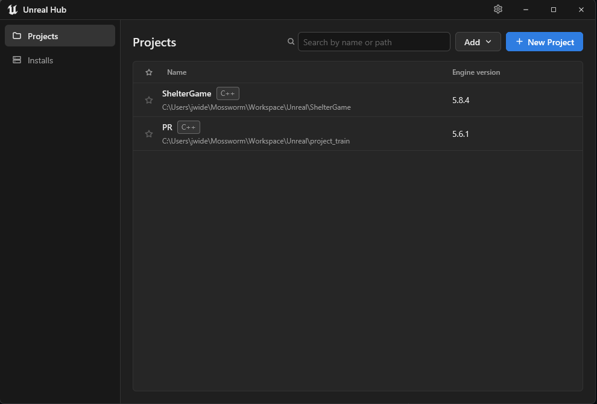
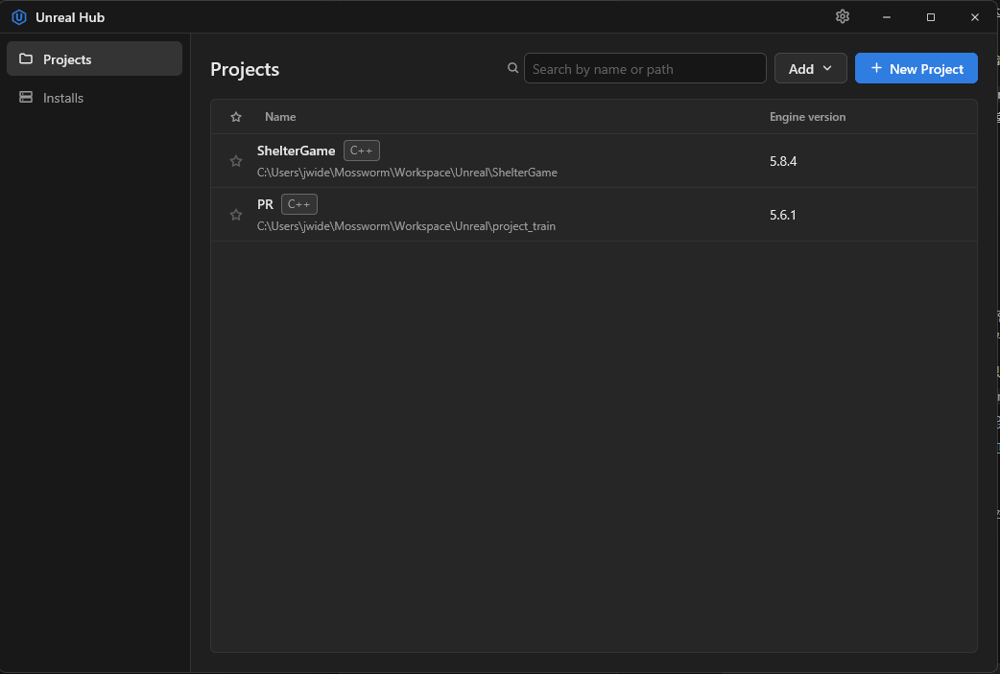
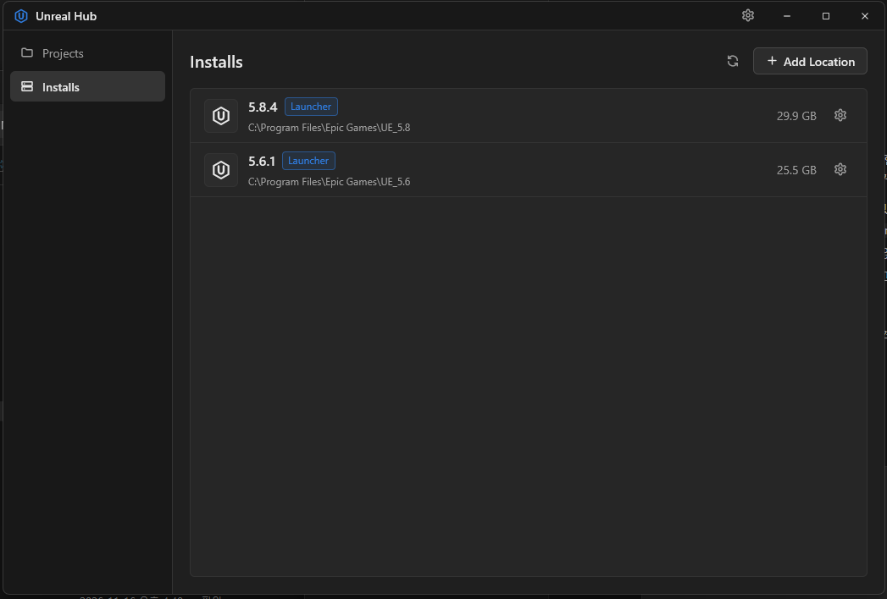
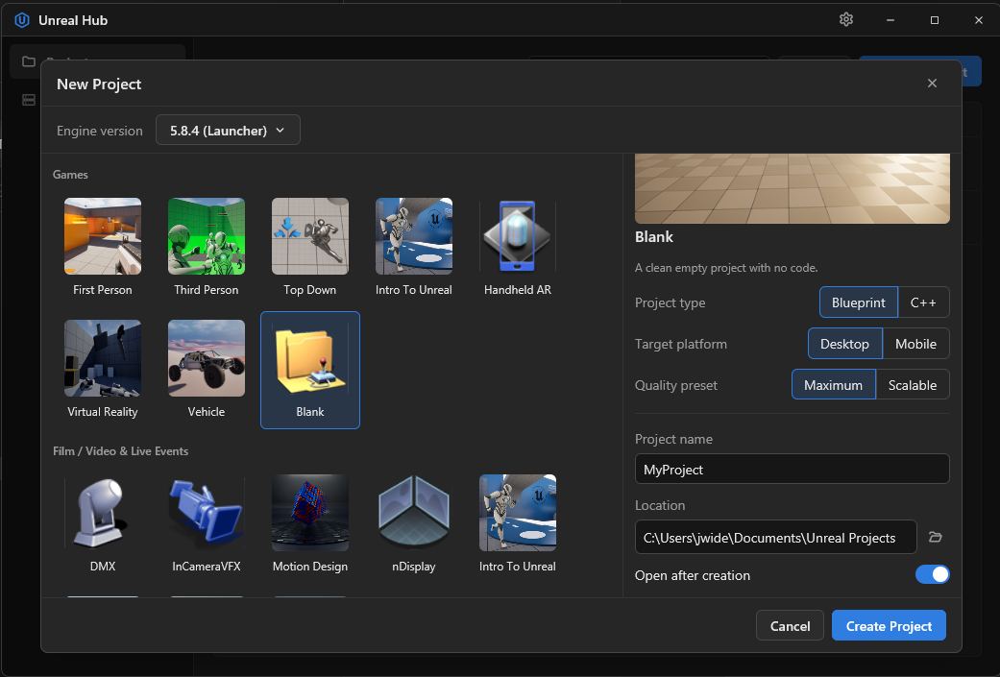
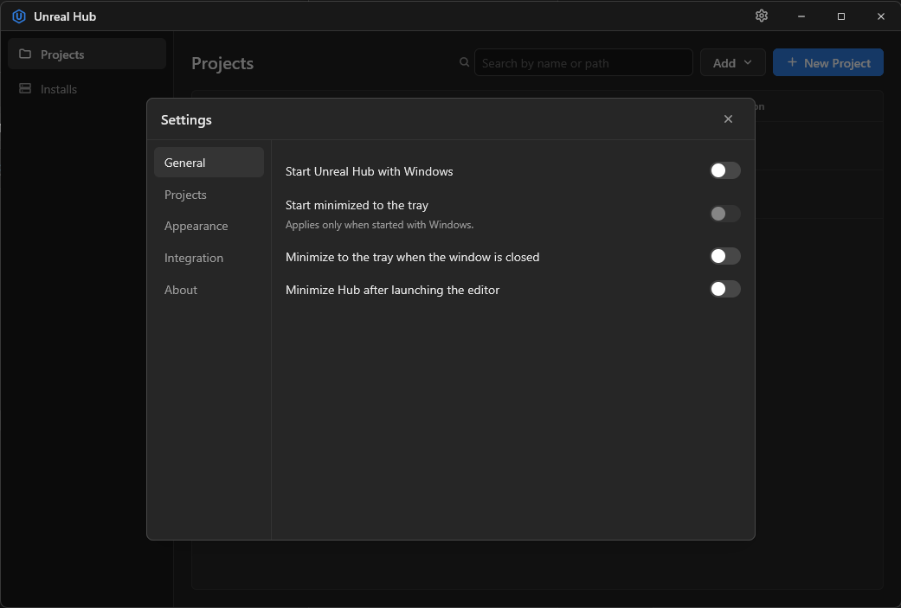

<p align="center">
  
</p>

<h1 align="center">Unreal Hub</h1>

<p align="center"><a href="README.md">English</a> · <b>한국어</b></p>

<p align="center">
  <b>프로젝트를 고르면, 맞는 엔진으로 열립니다.</b><br>
  <b>엔진 버전 관리</b>와 <b>프로젝트 열기</b>, 이 두 가지에만 집중한<br>
  빠르고 가벼운 언리얼 엔진 런처입니다. Rust와 <a href="https://www.gpui.rs/">GPUI</a>로 만들었습니다.
</p>

<p align="center">
  <a href="https://github.com/Mossworm/unreal-hub/releases/latest"></a>
</p>

<p align="center">
  <a href="LICENSE"></a>
  
  
  </p>

https://github.com/user-attachments/assets/d5e60edd-c5df-4ff2-97bb-1be7849e48c6

<p align="center">
  <br>
  <sub>내 컴퓨터의 모든 언리얼 프로젝트를 한 목록에서, 각자 필요한 엔진과 함께.</sub>
</p>

<table align="center">
  <tr>
    <td align="center" width="50%"><br><sub>프로젝트 목록</sub></td>
    <td align="center" width="50%"><br><sub>설치된 엔진</sub></td>
  </tr>
  <tr>
    <td align="center" width="50%"><br><sub>새 프로젝트</sub></td>
    <td align="center" width="50%"><br><sub>설정</sub></td>
  </tr>
</table>

---

## 왜 Unreal Hub인가

Epic Games Launcher는 스토어, 라이브러리, 뉴스, 엔진 설치 관리자를 한 창에 모아 둔
앱입니다. 프로젝트 하나 열고 싶을 뿐인데 기다릴 게 많습니다. 엔진 버전이 여러 개이거나
런처 설치 엔진 옆에 소스 빌드까지 있으면, 어떤 프로젝트가 어떤 엔진을 쓰는지 헷갈리기도
쉽습니다.

Unreal Hub는 한 가지 일만 합니다. 런처와 에디터가 이미 가지고 있는 설정을 읽어서 모든
프로젝트와 모든 엔진을 찾고, 서로 짝을 맞춘 뒤, 클릭 한 번으로 프로젝트를 엽니다. 따로
설정할 것이 없습니다. 처음 실행하면 이미 프로젝트가 목록에 있습니다.

## 자주 묻는 질문

### Epic Games Launcher를 대신하나요?

아니요. 엔진 설치와 업데이트는 지금처럼 Epic Games Launcher(또는 소스 빌드)로 합니다.
Unreal Hub는 그다음 단계, 즉 프로젝트를 찾아서 맞는 엔진으로 여는 일을 맡습니다.

### 런처나 엔진 설정을 바꾸나요?

아니요. Epic과 엔진의 설정 파일은 읽기만 하고 절대 쓰지 않습니다. Epic Games Launcher가
실행 중일 때 그 파일을 고치면 덮어써지거나 설정이 망가질 수 있기 때문에, 허브에 필요한
정보는 모두 `%APPDATA%\UnrealHub` 아래 자체 파일에 저장합니다.

### 소스 빌드 엔진도 되나요?

네. 컴퓨터에 등록된 소스 빌드를 런처 설치 엔진과 함께 찾고, GUID나 사용자 지정 이름으로
엔진을 지정한 프로젝트도 그 엔진과 연결합니다.

### 어떤 언리얼 버전을 지원하나요?

Unreal Engine 5.6 ~ 5.9에서 테스트했습니다. 그 이전 버전도 감지와 실행은 됩니다.

### macOS나 Linux에서도 되나요?

아직은 아닙니다. 지금은 Windows만 지원합니다. 플랫폼별 코드는 따로 분리해 두어서 나중에
다른 플랫폼을 추가할 수 있습니다.

### 무료인가요?

네. Unreal Hub는 MIT 라이선스의 오픈 소스입니다.

## 주요 기능

- **하나의 프로젝트 목록.** Epic Games Launcher의 프로젝트 폴더, 에디터 최근 프로젝트,
  직접 추가한 폴더를 중복 없이 하나로 합칩니다. 이름이나 경로로 검색하고, 자주 여는
  프로젝트는 즐겨찾기로 고정할 수 있습니다.
- **엔진 자동 감지.** 런처로 설치한 엔진과 소스 빌드를 찾고, 각 프로젝트가 쓰는 엔진을
  옆에 표시합니다.
- **클릭 한 번으로 열기.** 맞는 에디터를 별도 프로세스로 실행하므로 에디터가 뜨는 동안에도
  허브가 멈추지 않습니다. 이미 열려 있는 프로젝트는 따로 표시합니다.
- **C++ 프로젝트는 먼저 빌드.** C++ 프로젝트의 에디터 모듈을 빌드해야 하면 진행률을
  보여 주며 빌드한 뒤 에디터를 열고, 실패하면 로그를 보여 줍니다.
- **툴체인 확인.** 엔진에 필요한 Visual Studio 구성 요소와 .NET 런타임을 확인하고, 빠진
  것은 허브에서 설치할 수 있습니다.
- **프로젝트 관리.** 엔진 템플릿으로 새 프로젝트 만들기, 엔진 버전 변경(먼저 `.uproject`를
  백업), 캐시 정리(휴지통으로 이동).
- **쓰지 않을 때는 조용히.** 시스템 트레이, Windows 시작 시 자동 실행, 한국어·영어 UI.
- **스스로 업데이트.** GitHub Releases에 새 버전이 올라오면 앱 안에 배너로 알려 줍니다.

## 설치

1. **내려받기** — [Releases](https://github.com/Mossworm/unreal-hub/releases/latest)에서
   `UnrealHubSetup.exe`를 받습니다.
2. **실행하기** — 관리자 권한 없이 `%LOCALAPPDATA%\Programs\Unreal Hub`에 설치됩니다.
3. **프로젝트 열기** — 처음 실행할 때 기존 프로젝트와 엔진을 자동으로 찾아 줍니다.

사용자 데이터는 `%APPDATA%\UnrealHub`에 저장되며, 제거해도 남습니다.

> [!NOTE]
> 설치 파일은 코드 서명되어 있지 않아 Windows SmartScreen 경고가 뜰 수 있습니다.
> **추가 정보** → **실행**을 눌러 진행합니다.

## 동작 방식

```
GameUserSettings.ini (launcher project roots) ──┐
EditorSettings.ini   (recently opened)  ────────┼──▶ project list ──┐
Folders you add                          ───────┘                   │
                                                                    ├──▶ Unreal Hub ──▶ UnrealEditor.exe
LauncherInstalled.dat (launcher installs) ──┐                       │                  (detached)
Registry Builds key   (source builds)  ─────┴──▶ engine list ───────┘
```

- 각 `.uproject`의 `EngineAssociation`을 읽어 엔진을 찾습니다. 런처 설치 엔진은 `5.6` 같은
  버전 문자열, 소스 빌드는 GUID나 사용자 지정 이름입니다.
- 프로젝트는 `.uproject` 전체 경로로 중복을 제거합니다. 등록된 폴더는 한 단계 깊이까지만
  찾고, 디스크 전체를 뒤지지 않습니다.
- 검색, 파일 파싱, 실행은 모두 백그라운드에서 처리하므로 창이 멈추지 않습니다.

## 개인 정보

모든 작업은 내 컴퓨터에서 이루어집니다. 허브의 설정, 프로젝트 목록, 로그는
`%APPDATA%\UnrealHub`에 있습니다. 네트워크 요청은 GitHub Releases 업데이트 확인과, 허브에서
설치를 요청했을 때의 Visual Studio Build Tools·.NET 다운로드(Microsoft)뿐입니다. 텔레메트리는
없습니다.

## 소스에서 빌드

[Rust](https://rustup.rs/) 안정 버전이 필요합니다.

```sh
cargo build --release
```

변경 사항을 보내기 전에 실행할 검사:

```sh
cargo fmt --check
cargo clippy --all-targets -- -D warnings
cargo test
```

<details>
<summary><b>설치 파일 만들기</b></summary>
<br/>

[Inno Setup 6](https://jrsoftware.org/isinfo.php)이 필요합니다
(`winget install JRSoftware.InnoSetup`).

```powershell
powershell -ExecutionPolicy Bypass -File scripts/build-installer.ps1
```

결과물은 `dist\UnrealHubSetup.exe`입니다.

</details>

<details>
<summary><b>릴리스</b></summary>
<br/>

`v1.2.3` 형식의 태그를 push하면 GitHub Actions가 검사·빌드 후 설치 파일을 첨부한 **초안
릴리스**를 만듭니다. 릴리스 노트를 다듬은 뒤 정식 릴리스로 게시해야 앱의 자동 업데이트에
잡힙니다. 자세한 절차는 [docs/RELEASE.md](docs/RELEASE.md)를 참고하세요.

</details>

## 상태

버전 1.0.0이며, 제작자가 매일 쓰고 있습니다. 아직 다듬어지지 않은 부분이 있습니다.

- 지금은 Windows만 지원합니다.
- 설치 파일은 서명되어 있지 않습니다. 설치 항목의 안내를 참고하세요.
- 5.6 ~ 5.9 엔진에서 테스트했습니다. 그 이전 버전은 감지·실행은 되지만 테스트가 적습니다.

버그 제보와 아이디어는 [issues](https://github.com/Mossworm/unreal-hub/issues)에 남겨 주세요.

## 무관 고지

Unreal Hub는 독립 오픈 소스 프로젝트이며, Epic Games와 제휴하거나 Epic Games의 보증·후원을
받지 않습니다. Unreal과 Unreal Engine은 Epic Games, Inc.의 상표 또는 등록 상표입니다.

## 라이선스

MIT — [LICENSE](LICENSE)를 참고하세요.
