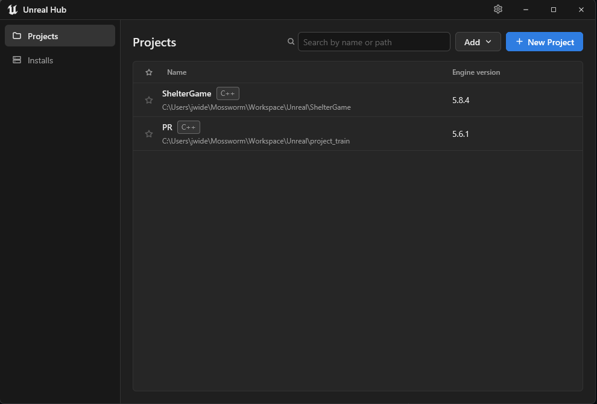
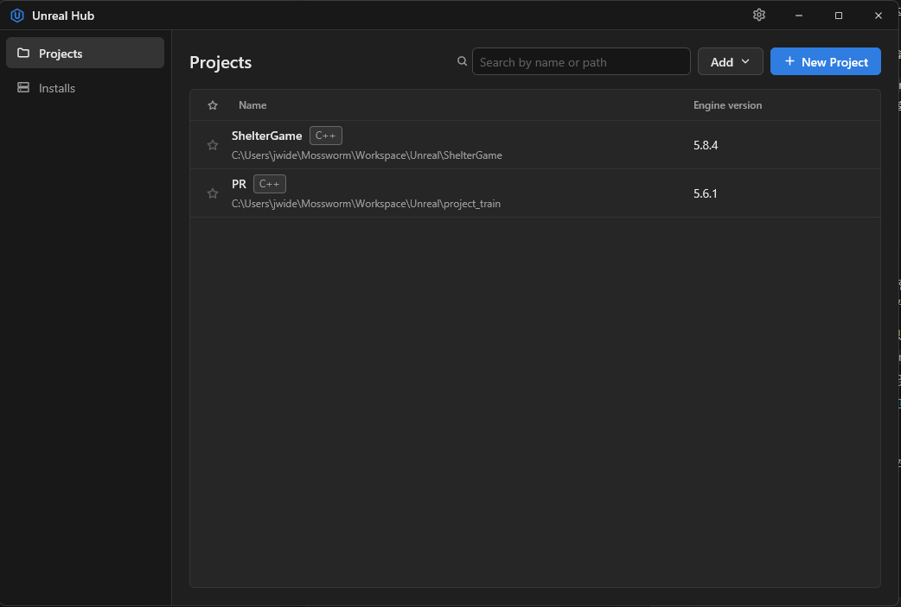
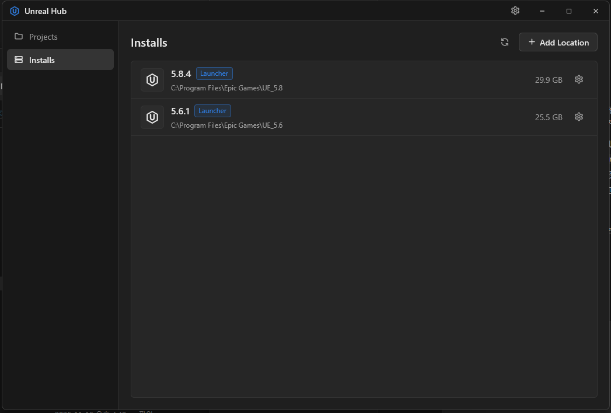
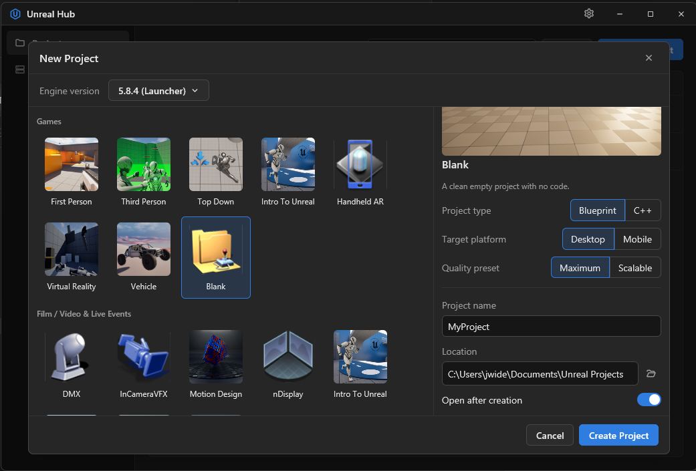
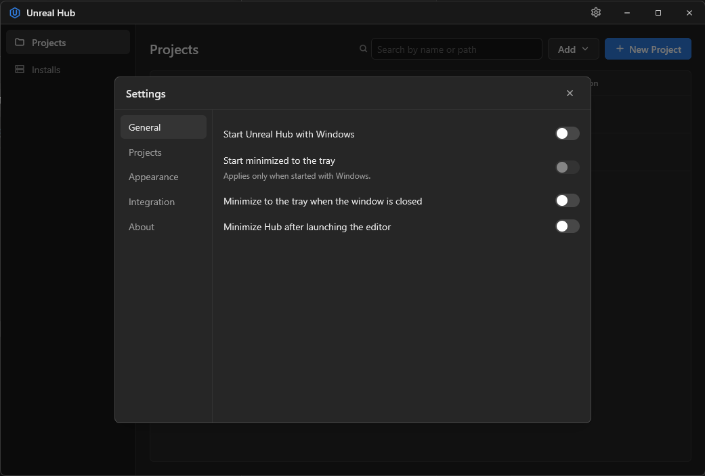

<p align="center">
  
</p>

<h1 align="center">Unreal Hub</h1>

<p align="center"><b>English</b> · <a href="README.ko.md">한국어</a></p>

<p align="center">
  <b>Pick a project. The right engine opens it.</b><br>
  A fast, lightweight launcher for Unreal Engine that does two things well:<br>
  keeping track of your <b>engine versions</b> and <b>opening your projects</b>. Built with Rust and <a href="https://www.gpui.rs/">GPUI</a>.
</p>

<p align="center">
  <a href="https://github.com/Mossworm/unreal-hub/releases/latest"></a>
</p>

<p align="center">
  <a href="LICENSE"></a>
  
  
  </p>

https://github.com/user-attachments/assets/d5e60edd-c5df-4ff2-97bb-1be7849e48c6

<p align="center">
  <br>
  <sub>Every Unreal project on your machine in one list, each matched to the engine it needs.</sub>
</p>

<table align="center">
  <tr>
    <td align="center" width="50%"><br><sub>Projects</sub></td>
    <td align="center" width="50%"><br><sub>Installed engines</sub></td>
  </tr>
  <tr>
    <td align="center" width="50%"><br><sub>New project</sub></td>
    <td align="center" width="50%"><br><sub>Settings</sub></td>
  </tr>
</table>

---

## Why Unreal Hub

The Epic Games Launcher is a store, a library, a news feed and an engine installer in one
window. When all you want is to open a project, that is a lot to wait for. And once you
have more than one engine version installed, or a source build next to launcher installs,
it is easy to lose track of which project goes with which engine.

Unreal Hub does one job. It reads the settings your launcher and editor already keep,
finds every project and every engine, matches them up, and opens the project with one
click. There is nothing to set up: on first launch your projects are already there.

## FAQ

### Does it replace the Epic Games Launcher?

No. You still install and update engines through the Epic Games Launcher (or build them
from source). Unreal Hub is for the part that comes after: finding a project and opening
it with the right engine.

### Will it change my launcher or engine settings?

No. Epic's files and the engine's config files are only read, never written. Writing to
them while the Epic Games Launcher runs gets overwritten and can break your setup, so the
hub keeps everything it needs in its own files under `%APPDATA%\UnrealHub`.

### Does it work with source-built engines?

Yes. Source builds registered on your machine are found next to launcher installs, and a
project that points at one by its GUID or custom name is matched to it.

### Which Unreal versions are supported?

Unreal Engine 5.6 to 5.9 are tested. Older versions are still detected and launched.

### Does it run on macOS or Linux?

Not yet. Windows is the only supported platform for now. The platform code is kept apart
so that others can be added later.

### Is it free?

Yes. Unreal Hub is open source under the MIT license.

## What you get

- **One project list.** Project folders from the Epic Games Launcher, the editor's recent
  projects and folders you add yourself, merged into one list without duplicates. Search
  by name or path, and star the ones you open most.
- **Engines found on their own.** Launcher installs and source builds, with the engine
  each project uses shown next to it.
- **One click to open.** The matching editor starts as its own process, so the hub never
  freezes while it loads. Projects that are already open are marked.
- **C++ projects that build first.** When a C++ project's editor modules need building, the
  hub builds them with a progress bar before the editor opens, and shows the log if it fails.
- **Toolchain check.** The Visual Studio components and .NET runtime an engine needs are
  checked, and what is missing can be installed from the hub.
- **Project management.** Create a project from the engine's templates, switch a project
  to another engine version (the `.uproject` is backed up first), and clean caches by
  moving them to the Recycle Bin.
- **Quiet when you are not using it.** System tray, start with Windows, and English and
  Korean UI.
- **Updates itself.** New versions from GitHub Releases show up as a banner in the app.

## Install

1. **Download** `UnrealHubSetup.exe` from [Releases](https://github.com/Mossworm/unreal-hub/releases/latest).
2. **Run it.** No administrator rights needed. The app installs to
   `%LOCALAPPDATA%\Programs\Unreal Hub`.
3. **Open a project.** Your existing projects and engines are picked up on first launch.

Your data lives in `%APPDATA%\UnrealHub` and stays when you uninstall.

> [!NOTE]
> The installer is not code-signed, so Windows SmartScreen may warn about it. Choose
> **More info** → **Run anyway** to continue.

## How it works

```
GameUserSettings.ini (launcher project roots) ──┐
EditorSettings.ini   (recently opened)  ────────┼──▶ project list ──┐
Folders you add                          ───────┘                   │
                                                                    ├──▶ Unreal Hub ──▶ UnrealEditor.exe
LauncherInstalled.dat (launcher installs) ──┐                       │                  (detached)
Registry Builds key   (source builds)  ─────┴──▶ engine list ───────┘
```

- Each `.uproject` is read for its `EngineAssociation`: a version such as `5.6` for
  launcher installs, or a GUID or custom name for source builds.
- Projects are deduplicated by their full `.uproject` path. Registered folders are scanned
  one level deep; the hub never walks your whole disk.
- Scans, file parsing and launches run in the background, so the window stays responsive.

## Privacy

Everything runs on your machine. The hub's own settings, project list and logs are in
`%APPDATA%\UnrealHub`. The only network requests are the update check against GitHub
Releases, and the Microsoft downloads for Visual Studio Build Tools or .NET when you ask
the hub to install them. There is no telemetry.

## Build from source

You need stable [Rust](https://rustup.rs/).

```sh
cargo build --release
```

Checks to run before you send a change:

```sh
cargo fmt --check
cargo clippy --all-targets -- -D warnings
cargo test
```

<details>
<summary><b>Building the installer</b></summary>
<br/>

The installer needs [Inno Setup 6](https://jrsoftware.org/isinfo.php)
(`winget install JRSoftware.InnoSetup`).

```powershell
powershell -ExecutionPolicy Bypass -File scripts/build-installer.ps1
```

The output is `dist\UnrealHubSetup.exe`.

</details>

<details>
<summary><b>Releasing</b></summary>
<br/>

Pushing a tag such as `v1.2.3` makes GitHub Actions check, build and create a **draft
release** with the installer attached. Edit the release notes, then publish it so the
in-app updater sees it. The full steps are in [docs/RELEASE.md](docs/RELEASE.md).

</details>

## Status

Version 1.0.0, in daily use by the author. Expect rough edges:

- Windows only for now.
- The installer is unsigned; see the note under Install.
- Engines from 5.6 to 5.9 are tested; older ones are detected and launched but get less
  testing.

Bug reports and ideas are welcome in [issues](https://github.com/Mossworm/unreal-hub/issues).

## Not affiliated

Unreal Hub is an independent open-source project. It is not affiliated with, endorsed by,
or sponsored by Epic Games. Unreal and Unreal Engine are trademarks or registered
trademarks of Epic Games, Inc.

## License

MIT — see [LICENSE](LICENSE).
